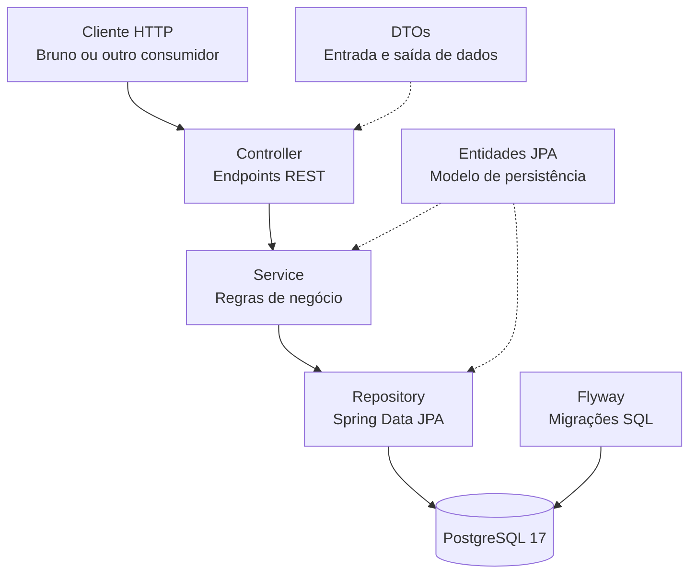

# Arquitetura do Sistema — Comércio Eletrônico

**Projeto:** Comércio Eletrônico — API REST  
**Versão:** 1.0  
**Arquitetura:** Aplicação monolítica organizada em camadas

## 1. Objetivo

Este documento apresenta a arquitetura da API REST de Comércio Eletrônico, descrevendo os principais componentes, suas responsabilidades e a comunicação entre as camadas.

A aplicação foi desenvolvida com Java 17, Spring Boot 4.1.2 e PostgreSQL 17.

## 2. Visão geral da arquitetura

O sistema utiliza uma arquitetura monolítica organizada em camadas, com separação de responsabilidades entre controllers, services e repositories.

Essa organização facilita a manutenção, os testes e a evolução da aplicação.

### Diagrama de arquitetura



## 3. Componentes da aplicação

### 3.1. Controller

Responsável por receber requisições HTTP, validar os dados de entrada e devolver respostas ao cliente.

Controllers implementados:

- `CategoriaController`
- `MarcaController`
- `EtiquetaController`
- `ProdutoController`

As operações utilizam os métodos HTTP GET, POST, PUT e DELETE.

### 3.2. DTO — Data Transfer Object

Os DTOs representam os dados recebidos e retornados pela API.

Permitem separar a representação das requisições e respostas das entidades utilizadas na persistência.

Exemplos:

- `ProdutoDto`
- `ProdutoRespostaDto`
- `CategoriaDto`
- `CategoriaRespostaDto`
- `MarcaDto`
- `MarcaRespostaDto`
- `EtiquetaDto`
- `EtiquetaRespostaDto`

As validações de entrada utilizam Jakarta Bean Validation.

### 3.3. Service

Responsável pela execução das regras de negócio.

Services da aplicação:

- `CategoriaService`
- `MarcaService`
- `EtiquetaService`
- `ProdutoService`

Entre as responsabilidades estão verificar a existência de registros, validar associações e coordenar as operações de cadastro, consulta, atualização e exclusão.

### 3.4. Repository

Responsável pelo acesso aos dados utilizando Spring Data JPA.

Os repositórios permitem realizar operações de persistência e consultas ao banco PostgreSQL.

### 3.5. Entity

As entidades representam os objetos persistidos no banco de dados.

Principais entidades:

- `CategoriaEntity`
- `MarcaEntity`
- `EtiquetaEntity`
- `ProdutoEntity`

Os relacionamentos são definidos com anotações JPA, como `@ManyToOne` e `@ManyToMany`.

### 3.6. Banco de dados

O PostgreSQL 17 é utilizado para armazenar as informações do catálogo.

No ambiente de desenvolvimento, o banco é executado por meio do Docker Compose.

A aplicação utiliza Spring Data JPA para acessar os dados.

### 3.7. Flyway

O Flyway é responsável pelo versionamento e pela execução das migrações SQL.

As migrações ficam armazenadas em:

`src/main/resources/db/migration/`

A configuração do Hibernate utiliza `ddl-auto=validate`, permitindo validar o mapeamento das entidades em relação ao esquema existente.

### 3.8. Tratamento de exceções

A aplicação possui um pacote dedicado ao tratamento de exceções.

Esse componente permite organizar o tratamento de situações de erro previstas pela aplicação.

## 4. Fluxo de uma requisição

Como exemplo, considere o cadastro de um produto.

1. O cliente envia uma requisição POST para `/produtos`.
2. O `ProdutoController` recebe os dados utilizando `ProdutoDto`.
3. O Spring aplica as validações declaradas no DTO.
4. O controller encaminha os dados ao `ProdutoService`.
5. O service verifica as associações com categoria, marca e etiquetas.
6. O repository realiza a persistência utilizando Spring Data JPA.
7. O PostgreSQL armazena o produto.
8. O controller converte o resultado em `ProdutoRespostaDto`.
9. A API retorna uma resposta HTTP `201 Created`.

## 5. Organização dos pacotes

A estrutura principal do código segue a organização:

```text
br.com.portfolio.comercioeletronico
│
├── controller
│   └── dto
│
├── entity
│
├── exception
│
├── repository
│
└── service
```

Cada pacote reúne classes com responsabilidades relacionadas.

## 6. Testes automatizados

O projeto utiliza JUnit 5 e Mockito para testar regras de negócio.

O serviço de produtos possui testes unitários que verificam operações de cadastro, consulta, atualização, exclusão e validação de associações.

Os testes ficam em `src/test/java`.

## 7. Considerações arquiteturais

A primeira versão utiliza uma arquitetura monolítica, adequada ao escopo atual de gerenciamento de catálogo.

A separação em camadas permite evoluir o projeto sem exigir uma arquitetura distribuída ou a adoção de microsserviços.

A aplicação ainda não contempla funcionalidades como autenticação, carrinho de compras, pedidos ou pagamentos.

Esses recursos poderão ser incorporados em versões futuras, conforme a evolução dos requisitos.

## 8. Considerações finais

A arquitetura adotada organiza o código por responsabilidades, utiliza recursos do ecossistema Spring e mantém a persistência de dados separada da camada HTTP.

O documento deverá ser atualizado sempre que ocorrerem mudanças relevantes na estrutura da aplicação.