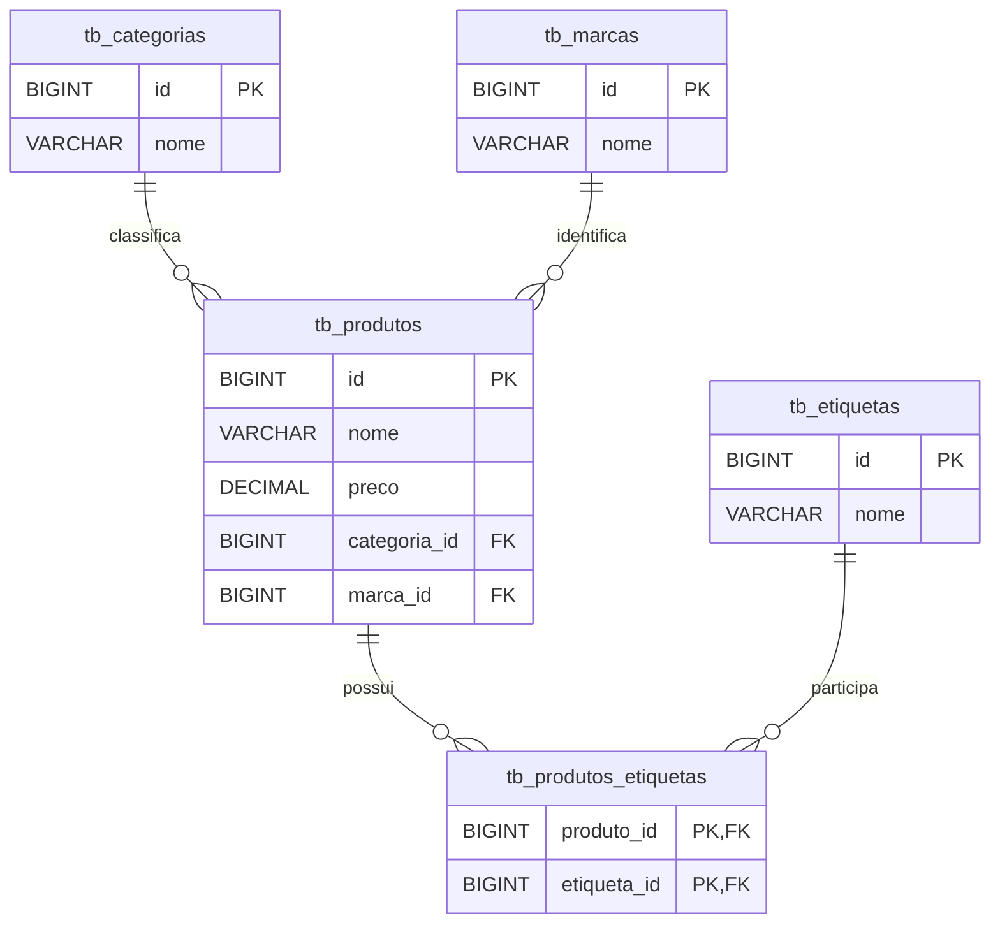

# Diagrama Entidade-Relacionamento — Comércio Eletrônico

**Projeto:** Comércio Eletrônico — API REST  
**Versão:** 1.0

## 1. Objetivo

Este documento apresenta o modelo de dados utilizado pela API de Comércio Eletrônico, incluindo as entidades, seus principais atributos e relacionamentos.

O modelo foi elaborado com base nas entidades JPA e nas migrações Flyway do projeto.

## 2. Diagrama entidade-relacionamento

## 3. Descrição das entidades

### 3.1. Categorias

A tabela `tb_categorias` armazena as categorias utilizadas na classificação dos produtos.

Principais atributos:

- `id`: identificador da categoria.
- `nome`: nome da categoria.

Uma categoria pode estar associada a vários produtos.

### 3.2. Marcas

A tabela `tb_marcas` armazena as marcas dos produtos.

Principais atributos:

- `id`: identificador da marca.
- `nome`: nome da marca.

Uma marca pode estar associada a vários produtos.

### 3.3. Produtos

A tabela `tb_produtos` armazena os produtos cadastrados.

Principais atributos:

- `id`: identificador do produto.
- `nome`: nome do produto.
- `preco`: preço do produto.
- `categoria_id`: referência à categoria.
- `marca_id`: referência à marca.

Cada produto possui associações com uma categoria e uma marca no modelo da aplicação.

### 3.4. Etiquetas

A tabela `tb_etiquetas` armazena etiquetas que podem ser associadas aos produtos.

Principais atributos:

- `id`: identificador da etiqueta.
- `nome`: nome da etiqueta.

Uma etiqueta pode estar associada a vários produtos.

### 3.5. Produtos e etiquetas

A tabela `tb_produtos_etiquetas` representa a associação entre produtos e etiquetas.

Possui os campos:

- `produto_id`: referência ao produto.
- `etiqueta_id`: referência à etiqueta.

Os dois campos formam uma chave primária composta, impedindo a repetição da mesma associação.

## 4. Integridade e unicidade

As migrações Flyway definem índices únicos normalizados para os nomes de categorias, marcas e etiquetas.

Esses índices utilizam `LOWER(TRIM(nome))`, impedindo nomes duplicados que diferem apenas por letras maiúsculas/minúsculas ou espaços nas extremidades.

A tabela `tb_produtos_etiquetas` possui chaves estrangeiras para produtos e etiquetas.

## 5. Observações sobre o modelo

O diagrama apresenta o modelo lógico identificado nas entidades JPA e nas migrações disponíveis.

As tabelas de categorias, marcas e produtos já existiam antes das migrações analisadas. Por isso, tipos SQL, restrições de nulidade e demais características dessas tabelas devem ser confirmados diretamente no esquema do PostgreSQL para uma documentação física completa.

## 6. Considerações finais

O modelo de dados permite organizar o catálogo de produtos e estabelecer relacionamentos entre produtos, categorias, marcas e etiquetas.

O diagrama deverá ser atualizado sempre que a estrutura de persistência for modificada.